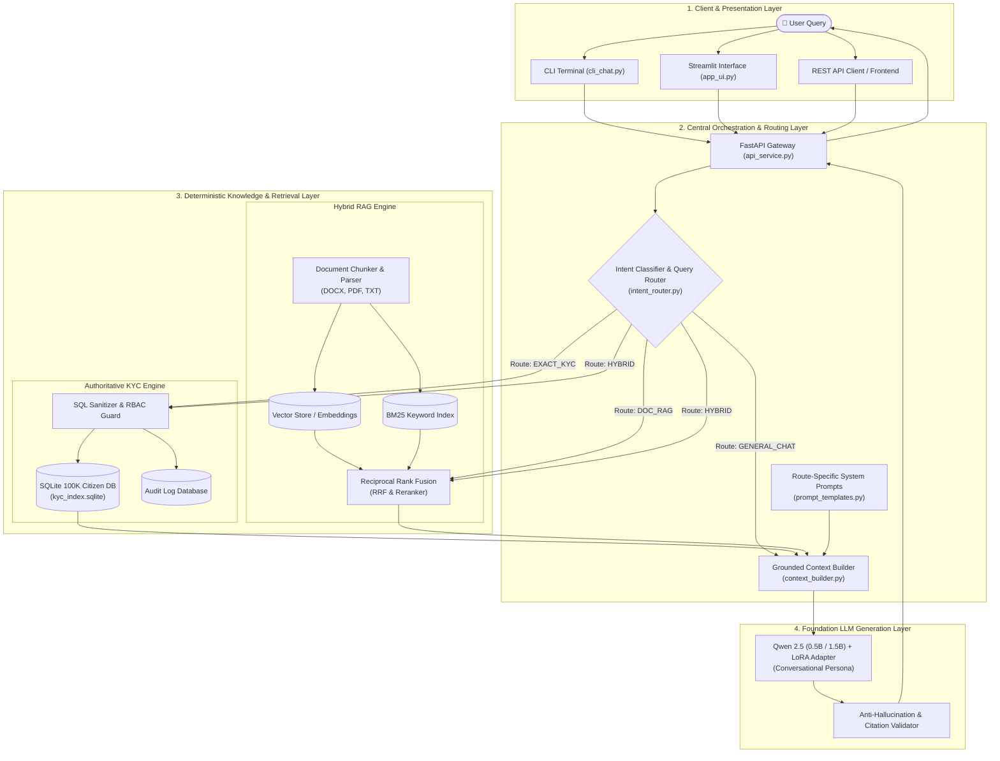
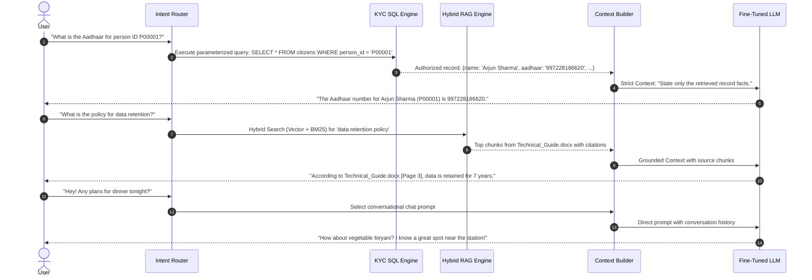

# Architecture Diagrams & System Flow
**Project:** Hybrid RAG + Fine-Tuned Foundation LLM + Exact KYC System
**Target:** Existing_LLM_Project

---

## 1. End-to-End System Architecture Diagram

---

## 2. Sequence Diagram: Exact KYC vs. Document RAG vs. Conversational

